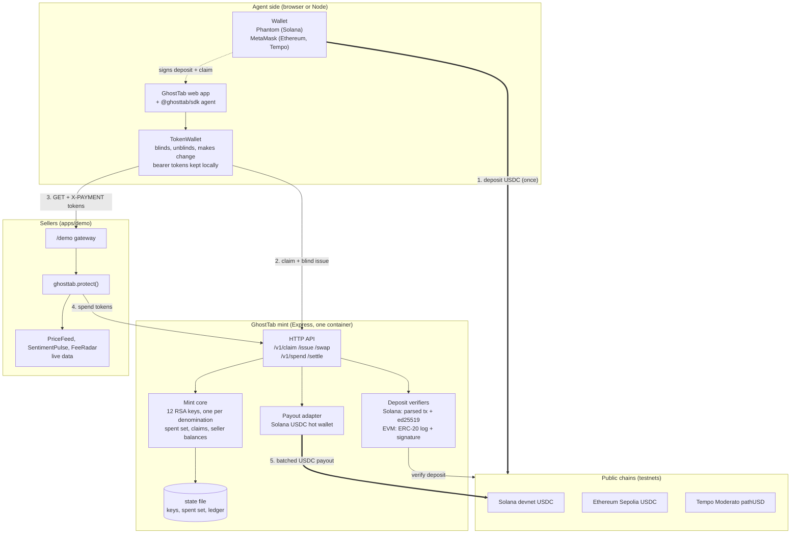
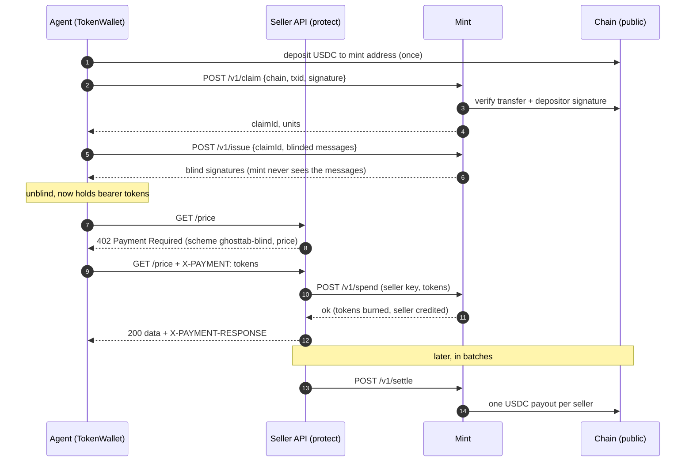

# GhostTab

**Private pay-per-call payments for AI agents.** Fund a tab once on Solana, Tempo or Ethereum, then pay for APIs over
[x402](https://x402.org) with blind-signed credit. The chain sees one deposit and batched seller payouts. It never
sees which wallet bought what, or when.

* **Live demo (devnet):** https://ghosttab.onrender.com (free tier, sleeps when idle: open it a minute early)
* **Code:** https://github.com/Prasannaverse13/ghosttab
* **Built for:** Colosseum's Crypto World's Fair hackathon (Solana, Tempo, Zcash, Ethereum)

---

## The problem

x402 makes HTTP 402 usable: an agent sees a price, pays, and gets the data. But every paid call is a public on-chain
receipt. Anyone can read which data your trading agent buys, from whom, how often, and exactly when. For an agent,
that data diet *is* the strategy.

|  | Plain x402 | GhostTab |
| --- | --- | --- |
| On-chain events for 9 paid calls | 9 payments, all from one wallet | 1 deposit + 3 batched payouts (one per seller) |
| Who bought what | Public | Not recoverable from the chain |
| Per-call latency | One on-chain tx per call | None: calls are settled off-chain, online |
| Chains | Whatever the seller supports | Fund on Solana, Tempo or Ethereum; sellers are paid in Solana USDC |

## How it works in one minute

1. **Deposit** USDC to the mint and sign a claim message with the same wallet.
2. The mint verifies the deposit **on-chain** and returns a secret claim ticket.
3. Your agent **blinds** random token messages. The mint signs them without seeing them (RSA blind signatures,
   RFC 9474), one key per denomination. The mint cannot link a token it later sees to the deposit that paid for it.
4. The agent calls a paid API, gets `402 Payment Required` (scheme `ghosttab-blind`) and retries with
   `X-PAYMENT: <tokens>`.
5. The seller's middleware sends the tokens to the mint (`/v1/spend`). The mint verifies the signature, burns the
   tokens (double-spend protection) and credits the seller. The seller returns the data with `200`.
6. Sellers are paid out in **batches** (`/v1/settle`): one real USDC transfer each, not one per call.

1 credit unit = $0.001. Denominations: 1, 2, 5, 10, 20, 50, 100, 200, 500, 1000, 2000, 5000 units.

## Architecture



PNG copies for slides and forms: [docs/architecture.png](docs/architecture.png), [docs/sequence.png](docs/sequence.png).

### One paid call



### Components

| Package | Role |
| --- | --- |
| `packages/core` | Isomorphic mint, token wallet and x402 helpers. Same code runs in Node and in the browser. |
| `packages/server` | Express mint API, JSON-file state, Solana and EVM deposit verifiers, Solana payout adapter, `/demo` gateway, static site. |
| `packages/sdk` | `ghosttab.agent()` (x402 client that pays automatically) and `ghosttab.protect()` (Express paywall middleware). |
| `apps/demo` | Three paid APIs backed by live data, plus an autonomous CLI agent. |
| `web` | Landing page and app. Wallet-only (no accounts): Phantom, MetaMask. Esbuild-bundled TypeScript. |
| `scripts` | `keygen` (fresh Solana keys), `check` (balances), `send` (fund test wallets), `start.sh` (container entrypoint). |

## Tools and technologies, and how each is used

| Tool | Where | How we use it |
| --- | --- | --- |
| **x402 / HTTP 402** | `core/x402.ts`, `sdk` | Payment protocol. A custom scheme `ghosttab-blind` carries blind tokens in `X-PAYMENT` and returns a receipt in `X-PAYMENT-RESPONSE`. |
| **RFC 9474 RSA blind signatures** (`@cloudflare/blindrsa-ts`) | `core/mint.ts`, `core/wallet.ts` | Core privacy primitive. RSABSSA SHA-384 PSS (deterministic), 2048-bit keys, one key per denomination. Verified in the browser with WebCrypto RSA-PSS. |
| **Solana** (`@solana/web3.js`, `@solana/spl-token`, `tweetnacl`, `bs58`) | `server/chains/solana.ts`, `server/payout.ts`, `web/src/wallets.ts` | Deposit chain and payout chain. Deposits are verified with `getParsedTransaction` (SPL-USDC transfer to the mint) and an ed25519 claim signature. Payouts are real SPL-USDC transfers from the mint hot wallet. |
| **Phantom** (injected provider) | `web/src/wallets.ts` | Solana wallet: builds and sends the USDC transfer, signs the claim message. |
| **Ethereum Sepolia** (`viem`) | `server/chains/evm.ts` | Deposit chain. We read the ERC-20 `Transfer` log to the mint address and recover the depositor with `recoverMessageAddress`. |
| **Tempo Moderato testnet** (`viem`) | `server/chains/evm.ts`, `server/config.ts` | Deposit chain (chain id 42431, `pathUSD`, 6 decimals). Same EVM verifier. MetaMask is prompted to add the network via `wallet_addEthereumChain`. |
| **MetaMask** (EIP-1193) | `web/src/wallets.ts` | Ethereum and Tempo wallet: sends the ERC-20 transfer, signs the claim. |
| **Circle USDC** | config | Devnet USDC mint `4zMMC9sr…ncDU`, Sepolia USDC `0x1c7D…7238`. |
| **Zcash** | UI only | Shown as roadmap. Shielded deposits are the natural private on-ramp (not built). |
| **Express + cors** | `server`, `apps/demo` | Mint API, demo seller APIs and the `/demo` same-origin gateway (so one public URL serves site, mint and paid APIs). |
| **Live data sources** | `apps/demo/apis.ts` | PriceFeed: Coinbase SOL-USD. SentimentPulse: alternative.me Fear and Greed. FeeRadar: Solana `getRecentPrioritizationFees`. |
| **esbuild** | `web/build.mjs` | Bundles the browser app (ESM, code splitting). `buffer` is polyfilled for `@solana/web3.js` in the browser. |
| **TypeScript, tsx, npm workspaces** | everywhere | Monorepo, strict typecheck (`npm run typecheck`), run TypeScript directly. |
| **node:test** | `core/test` | 11 tests for issuance, double-spend (including concurrent), forgery, denomination relabelling, change-making, restart persistence. |
| **Docker + Render** | `Dockerfile`, `scripts/start.sh` | One container runs the mint, site and demo APIs. Deployed on Render's free tier. |
| **Playwright** | dev only | Used to test the wallet flows with a mocked provider and to render the demo video's motion graphics. |

## Security and privacy model

* **Double-spend protection.** A token's secret is reserved in the spent set synchronously, before any `await`, so two
  concurrent spends of the same token cannot both succeed. A dedicated test fires them concurrently.
* **Claim binding.** A deposit can only be redeemed by the wallet that made it: the claim carries a signature over
  `GhostTab claim / chain / txid` that the mint checks against the on-chain sender.
* **Denomination integrity.** Each denomination has its own key, so a token cannot be relabelled to a higher value.
* **What the mint learns.** At deposit: depositor and amount. At spend: seller and amount. Blind signing breaks the
  link between the two.
* **Honest limits.** The v1 mint is **custodial** (like Cashu): it holds deposits and could refuse to pay out, so keep
  balances small. Privacy grows with traffic: a mint with one user and one seller is correlatable by timing and amount.
  The mint's state file holds the private signing keys: keep it out of git and on a persistent volume.
* **Testnets only.** Everything in the live demo runs on devnet and testnets. Do not put real funds in v1.

## Status

| Piece | Status |
| --- | --- |
| Blind mint, token wallet, x402 scheme, seller middleware | Done. 11/11 tests pass. |
| Solana deposit verification and batched USDC payouts | **Exercised live on devnet**, from the CLI agent and from the browser with Phantom. |
| Wallet-gated web app, split "what the chain sees" ledger | Done and used end to end on the deployed site. |
| Ethereum Sepolia and Tempo Moderato deposits | Implemented and enabled on the mint; the MetaMask deposit path has not yet been run end to end. |
| Zcash shielded deposits | Roadmap |
| Federated mint (FROST threshold signatures) | Roadmap |
| On-chain settlement program (Anchor) | Roadmap |
| Mainnet | Not before the federated mint and deposit caps |

## Run it locally

Needs Node 22+.

```bash
npm install
npm run keygen         # prints fresh Solana keys and what to fund; copy .env.example to .env and paste them
npm run dev            # mint on http://localhost:8402, also serves the website and the app
# in two more terminals:
npm run demo:apis      # three paid APIs on :4020 with live data, settling to sellers every 30s
npm run demo:agent     # CLI agent: real devnet deposit, buys data, prints what the chain saw
npm test               # 11 tests
```

Fund the test wallets with devnet SOL and Circle devnet USDC (`npm run check` shows balances, `npm run send --
<address> [usdc] [sol]` sends from the mint wallet). Open http://localhost:8402/app.html, connect Phantom (Settings,
Developer Settings, Testnet Mode, so it is on devnet) and deposit. The mint refuses to start without a payout wallet and
at least one configured chain: there is no sandbox mode or simulated payout.

### Configuration (`.env`, see `.env.example`)

| Variable | Purpose |
| --- | --- |
| `SOLANA_PAYOUT_SECRET` | **Required.** Base58 secret key of the mint hot wallet. Pays sellers and, by default, receives deposits. |
| `SELLER_PAYOUT_ADDRESS` | Solana wallet that receives the demo sellers' USDC. |
| `AGENT_SOLANA_SECRET` | Funded wallet for `npm run demo:agent` (CLI only, not needed on the server). |
| `SOLANA_CLUSTER`, `SOLANA_RPC`, `SOLANA_USDC_MINT` | Cluster label, RPC URL and USDC mint (defaults: devnet and Circle devnet USDC). |
| `EVM_MINT_ADDRESS` | One deposit address for Ethereum and Tempo. |
| `EVM_ETHEREUM_RPC`, `EVM_ETHEREUM_USDC` | Sepolia RPC and USDC (defaults provided). |
| `EVM_TEMPO_RPC`, `EVM_TEMPO_USDC`, `EVM_TEMPO_CHAIN_ID` | Tempo overrides; Moderato defaults are built in. |
| `PORT`, `STATE_FILE`, `DEMO_API_URL`, `DEMO_PORT`, `SETTLE_MS` | Server port, state file path, demo API location and port, auto-settle interval (ms). |

## API

| Endpoint | Who | What |
| --- | --- | --- |
| `GET /v1/info` | anyone | Enabled chains, deposit addresses, networks, unit price. |
| `GET /v1/keys` | anyone | Public key for each denomination. |
| `POST /v1/claim` | depositor | `{chain, txid, signature}`: verify the deposit on-chain, return a claim ticket. |
| `POST /v1/issue` | depositor | `{claimId, outputs}`: blind-sign the submitted blinded messages. |
| `POST /v1/swap` | token holder | Swap tokens for new blinded tokens (change-making). |
| `POST /v1/sellers` | seller | Register, get a seller id and secret. |
| `POST /v1/spend` | seller | Present tokens: verify, burn, credit the seller. |
| `GET /v1/seller/balance` | seller | Current unsettled balance. |
| `POST /v1/settle` | seller | Pay the balance out on Solana in one batch. |
| `GET /v1/ledger`, `GET /v1/stats` | anyone | Public ledger (deposits and payouts only) and totals. |

### Seller integration

```ts
import { ghosttab } from '@ghosttab/sdk';
app.get('/whales', ghosttab.protect({ price: 0.01 }), handler);   // GHOSTTAB_MINT / _SELLER_ID / _SELLER_SECRET
```

### Agent integration

```ts
const agent = ghosttab.agent({ mint: 'https://ghosttab.onrender.com', maxUnitsPerCall: 50 });
await agent.fund(claimId, units);
const res = await agent.fetch('https://api.example.com/whales');   // 402 -> pay -> 200, automatically
```

## Deploy

One container serves the site, the mint API and the demo APIs (via `/demo`):

```bash
docker build -t ghosttab .
docker run -p 8080:8080 -v ghosttab-data:/data --env-file .env ghosttab
```

**Render (what the live demo uses):** New Web Service, runtime Docker, free instance. Set `SOLANA_PAYOUT_SECRET`,
`SELLER_PAYOUT_ADDRESS`, `EVM_MINT_ADDRESS`, `STATE_FILE=/tmp/mint.json`, `SOLANA_CLUSTER=devnet` and `SOLANA_RPC`.
Leave `PORT` unset. The free disk is ephemeral and the service sleeps when idle, so a restart creates new mint keys
and tokens saved in old browsers stop working (a fresh deposit works). For anything long-lived use a persistent volume
(`fly.toml` shows the Fly.io equivalent). Wallet connection needs HTTPS, which Render provides.

## Demo

* Walk-through and shot list: [docs/DEMO_SCRIPT.md](docs/DEMO_SCRIPT.md), narration: [docs/video/VOICEOVER.md](docs/video/VOICEOVER.md).
* Try it yourself on the live site: connect Phantom (devnet), deposit 1 USDC, **Run agent** (3 rounds, about $0.06),
  then read the split view. Sellers are auto-paid every 30 seconds; click **Settle sellers now** right after the run to
  watch a payout happen, or read the batched payouts already in the ledger.
* `docs/video/` also holds the source of the intro and outro motion graphics.

## Repository layout

```
packages/core     mint, token wallet, x402 helpers (+ tests)
packages/server   mint API, chain verifiers, payout adapter, /demo gateway
packages/sdk      agent client and seller middleware
apps/demo         paid demo APIs and CLI agent
web               landing page and app (TypeScript, bundled with esbuild)
scripts           keygen, check, send, container entrypoint
docs              demo script, video assets
```

## Roadmap

1. **Federated mint:** FROST threshold signatures so no single operator holds funds or keys.
2. **Shielded Zcash deposits** as the private on-ramp.
3. **Anchor program** for on-chain settlement and seller attestations.
4. **Mainnet** with deposit caps, after the federation lands.

## License

MIT. See [LICENSE](LICENSE).
